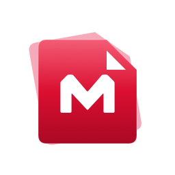
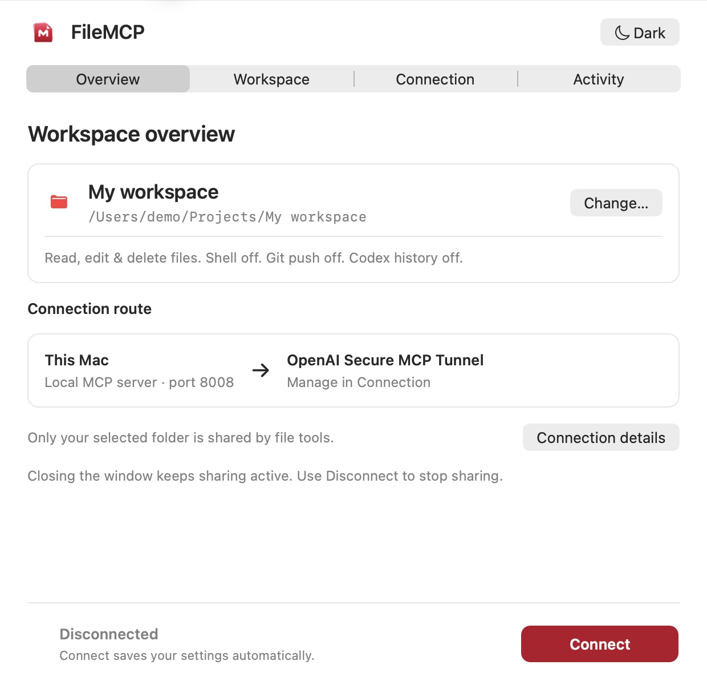
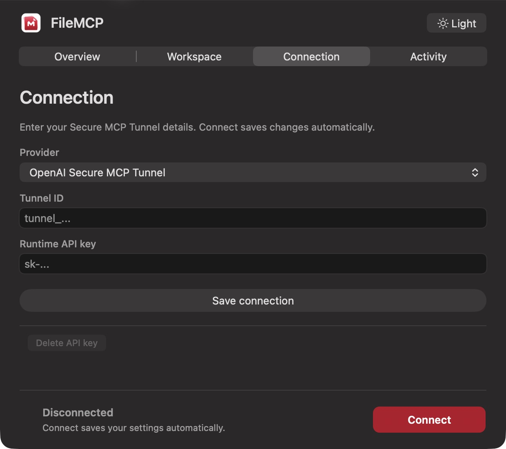

<p align="center">
  
</p>
<h1 align="center">FileMCP</h1>
<p align="center"><strong>Local MCP server for ChatGPT, Claude and Meta Muse AI.</strong></p>
<p align="center">
  
  
  
</p>
<p align="center">
  <a href="#quick-start">Quick start</a> ·
  <a href="#supported-clients">Supported clients</a> ·
  <a href="#mcp-tools">MCP tools</a> ·
  <a href="#security">Security</a> ·
  <a href="docs/technical-reference.md">Documentation</a>
</p>

FileMCP is an open-source, native macOS and Windows desktop application that connects AI assistants to your local files and code repositories using the **Model Context Protocol (MCP)**. Read and edit files, search code, perform Git operations and optionally execute shell commands from your AI assistant, without uploading an entire workspace.

Connect remotely through **OpenAI Secure MCP Tunnel** or **Cloudflare Tunnel with OAuth**. The MCP server runs on your own computer and binds only to loopback.

## Features

- **Filesystem MCP:** browse, read, write and search a selected local workspace.
- **AI coding tools:** repository overview, scoped context, code search and conflict-checked patches.
- **Git integration:** inspect changes, stage files, commit and optionally push.
- **Terminal access:** optional shell commands and cancellable command sessions.
- **Codex integration:** import conversations into local Codex history.
- **Native desktop apps:** Swift/AppKit on macOS and C#/.NET 8/WPF on Windows.
- **Controlled access:** workspace path checks, configurable permissions, credential storage and outbound tunnels.

## Supported clients

| Client | OpenAI Secure MCP Tunnel | Cloudflare Tunnel |
| --- | --- | --- |
| [ChatGPT](#chatgpt) | macOS, Windows | macOS |
| [Claude](#claude) | — | macOS |
| [Meta Muse AI](#meta-muse-ai) | — | macOS |
| Other compatible remote MCP clients | — | macOS |

Cloudflare support is currently macOS only. Client availability depends on account and workspace policies.

## Screenshots

<table>
  <tr>
    <td align="center"><a href="assets/screenshots/macos/overview-light.png"></a></td>
    <td align="center"><a href="assets/screenshots/macos/connection-dark.png"></a></td>
  </tr>
</table>

macOS interface with sample settings. [View all screenshots](docs/technical-reference.md#screenshots).

## Quick start

### macOS

Requires macOS 12+ and Xcode Command Line Tools.

```bash
git clone https://github.com/anhnv02/file-mcp.git
cd file-mcp
./build_macos_app.sh
open dist/FileMCP.app
```

Apple Silicon is bundled; Intel builds require additional upstream binaries.

### Windows

Requires Windows 10/11 and the .NET 8 SDK.

```powershell
git clone https://github.com/anhnv02/file-mcp.git
cd file-mcp
./build_windows_app.ps1 -Architecture x64
```

Use `-Architecture arm64` for Windows ARM64. Open the executable in `dist/windows-x64/FileMCP/` (or the corresponding ARM64 directory). Built packages are self-contained. Local builds on both platforms are unsigned.

### Configure FileMCP

1. Select the local folder in **Workspace** (macOS) or **Settings** (Windows).
2. Choose a connection provider below.
3. Click **Connect**. Keep FileMCP running while using your MCP client; select **Disconnect** to stop sharing.

Git must be installed to use Git tools. Enable additional permissions only when needed.

#### OpenAI Secure MCP Tunnel

Available on macOS and Windows. No public MCP hostname is required.

1. Create or select a tunnel for your OpenAI workspace.
2. Create a restricted Platform runtime API key with **Tunnels Read + Use** (tunnel management requires **Read + Manage**).
3. Enter the tunnel ID and runtime API key in FileMCP.

See the [Secure MCP Tunnel guide](https://developers.openai.com/api/docs/guides/secure-mcp-tunnels).

#### Cloudflare Tunnel (macOS)

Use this provider for Claude, Muse AI, or other remote MCP clients.

1. Install `cloudflared` with `brew install cloudflared`.
2. Create a Cloudflare Tunnel and route a public HTTPS hostname to `http://127.0.0.1:8008` (or your configured MCP port). Route the entire hostname, including OAuth and discovery paths.
3. In FileMCP, select the Cloudflare dashboard-token or cloudflared-login provider and configure the tunnel and hostname.
4. Connect and copy the MCP endpoint: `https://<hostname>/mcp`.
5. During client authorization, use OAuth with dynamic client registration (DCR) where supported. No static client secret is required. Review the client and permissions, then enter the FileMCP login code only on your own authorization page.

See [Cloudflare Tunnel documentation](https://developers.cloudflare.com/cloudflare-one/networks/connectors/cloudflare-tunnel/) and [authentication details](docs/technical-reference.md#cloudflare-authentication).

### Connect your MCP client

#### ChatGPT

In ChatGPT, open the custom MCP server setup under Plugins. Select your OpenAI tunnel or enter the Cloudflare HTTPS endpoint and use OAuth. See the [ChatGPT connection guide](https://developers.openai.com/plugins/deploy/connect-chatgpt).

#### Claude

In Claude, open **Customize → Connectors → Add custom connector**. Name it FileMCP, enter the Cloudflare HTTPS MCP endpoint and complete OAuth authorization. See the [Claude remote MCP guide](https://support.claude.com/en/articles/11175166-get-started-with-custom-connectors-using-remote-mcp).

#### Meta Muse AI

Ask Muse to create a custom connector using your remote MCP endpoint. For example:

> Create a custom connector named FileMCP for https://mcp.example.com/mcp using Streamable HTTP and OAuth.

Replace the example with your FileMCP endpoint. Follow the available authorization flow. Never paste the login code into chat. Custom connector behavior may vary by client version.

For any compatible remote MCP client, use the Cloudflare endpoint and OAuth. After connecting, start with a read-only request such as listing workspace files.

## MCP tools

| Category | Tools |
| --- | --- |
| Filesystem | `list_files`, `read_file`, `read_file_range`, `write_file`, `delete_file`, `delete_directory` |
| Search | `grep`, `glob`, `search_code`, `repo_overview`, `batch_read` |
| Coding | `workspace_context`, `edit_file`, `apply_patch` |
| Git | `git_init`, `git_status`, `git_log`, `git_diff`, `git_add`, `git_commit`, `git_push` |
| Terminal | `run_command`, `start_command`, `read_command_output`, `cancel_command` |
| Codex | `save_conversation_to_codex` |

Tool availability depends on platform and enabled permissions. See the [full tool reference](docs/technical-reference.md#available-mcp-tools).

## Security

- The MCP server listens on `127.0.0.1`; both tunnel providers establish outbound connections.
- File tools enforce workspace path containment, including symlink/reparse-point checks.
- Shell execution is disabled by default. macOS also provides separate Git push and Codex history permissions.
- Runtime credentials are stored in macOS Keychain or Windows Credential Manager.
- Cloudflare authentication uses OAuth with PKCE, expiring access tokens and rotating refresh tokens.
- Request sizes, search results, process output and execution time are bounded.

> [!WARNING]
> FileMCP can modify or delete workspace files. Shell commands are not OS-sandboxed and run with your OS user's permissions. Share only a trusted, narrowly scoped workspace.

[Full security model](docs/technical-reference.md#security-model) · [Report a vulnerability](SECURITY.md)

## Documentation

| Guide | Contents |
| --- | --- |
| [Technical reference](docs/technical-reference.md) | Platform support, settings, tools, architecture and MCP protocol compatibility |
| [Development and verification](docs/technical-reference.md#development-and-verification) | macOS and Windows build/test commands |
| [Release packaging](docs/technical-reference.md#release-packaging) | Source archive and distribution notes |
| [Contributing](CONTRIBUTING.md) | Development and contribution guidelines |
| [Changelog](CHANGELOG.md) | Release history |

## License

[Apache License 2.0](LICENSE). Vendored dependencies retain their [upstream licenses and notices](vendor/tunnel-client/README.md).

FileMCP is an independent open-source project, not an official product of OpenAI, Anthropic or Meta.
